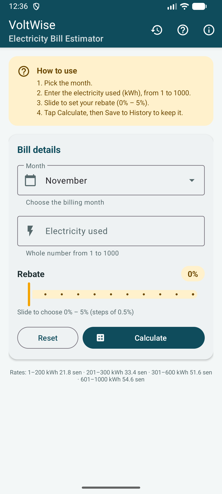
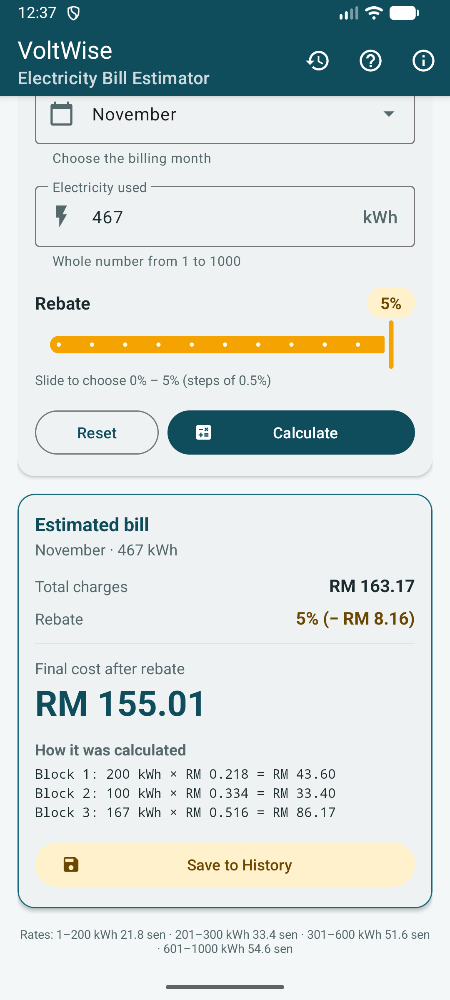
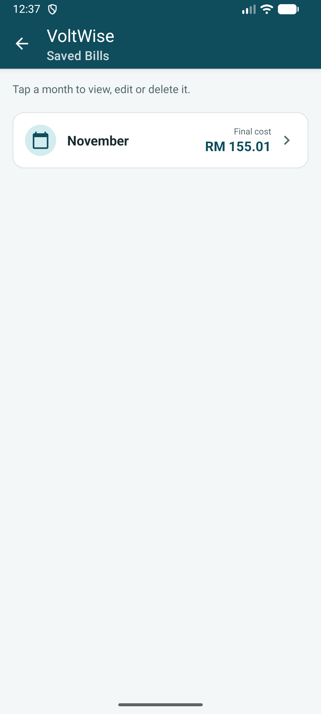
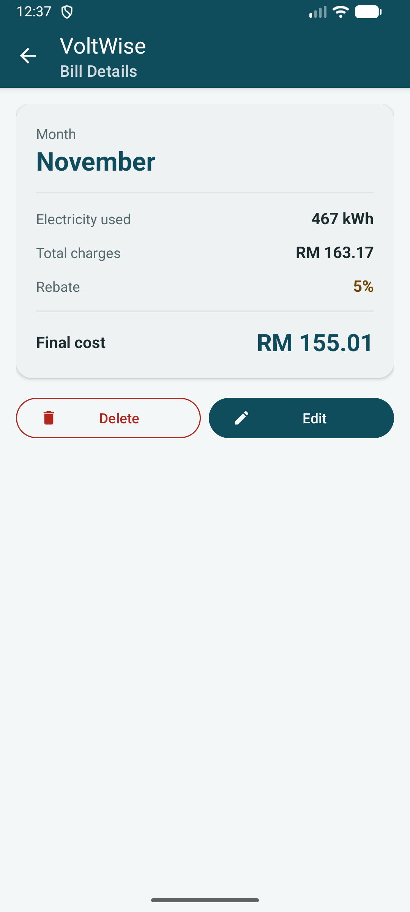
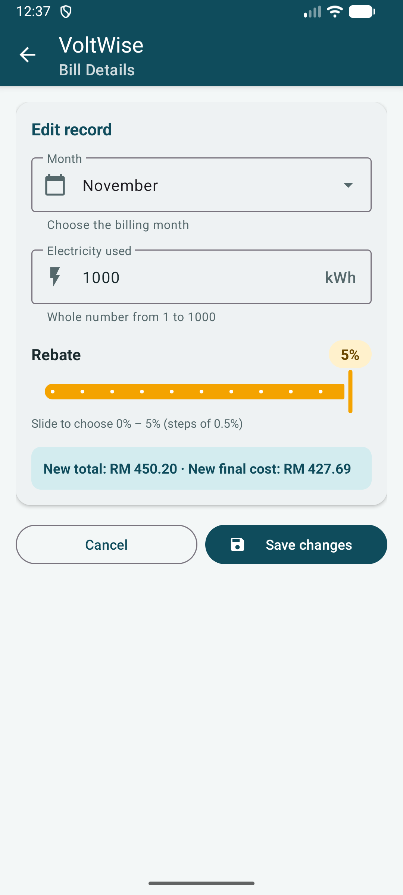
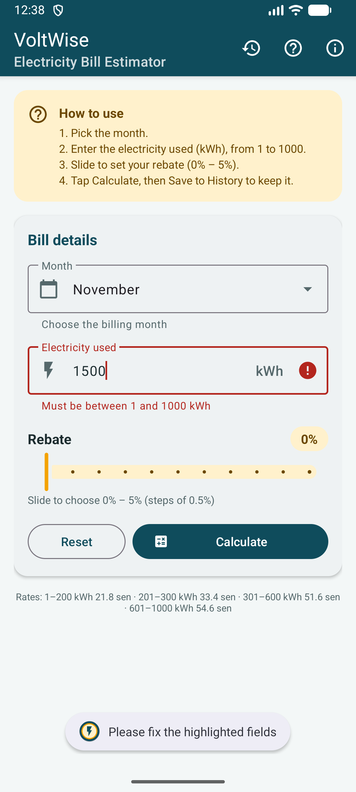
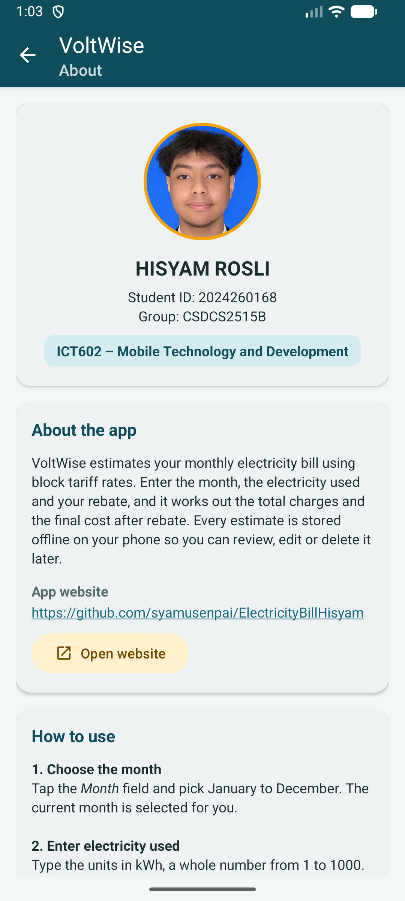

# VoltWise – Electricity Bill Estimator

An Android app that estimates a monthly electricity bill from block tariff rates, built for the **ICT602 Mobile Technology and Development** individual assignment.

**Student:** Hisyam Rosli · 2024260168 · CSDCS2515B

## Download

Signed APK: [`app/release/ICT602CS251-5B-HISYAMROSLI-VoltWise.apk`](app/release/ICT602CS251-5B-HISYAMROSLI-VoltWise.apk)

## Features

- **Inputs:** month (dropdown), electricity used in kWh (1–1000, numeric keyboard), rebate (slider, 0–5% in 0.5% steps)
- **Outputs:** total charges and final cost after rebate, shown on the same page with a block-by-block breakdown
- **Local SQLite database:** every calculation can be saved offline
- **Saved bills list:** a ListView showing month and final cost; tap a row to view full details, edit (recalculated live) or delete
- **Good design practice:** inline error messages, notices after save/update/delete, a duplicate-month warning, an on-screen how-to card and a help dialog
- **About page:** student details, app description, a clickable link to this repository and full usage instructions
- Custom teal/amber theme, branded title bar and a lightning-bolt launcher icon

## Tariff

| Block | Rate (sen/kWh) |
|---|---|
| First 200 kWh (1–200) | 21.8 |
| Next 100 kWh (201–300) | 33.4 |
| Next 300 kWh (301–600) | 51.6 |
| Next 400 kWh (601–1000) | 54.6 |

Final cost = Total charges − (Total charges × Rebate %)

Example: 467 kWh → 200 × 0.218 + 100 × 0.334 + 167 × 0.516 = **RM 163.17**; with a 5% rebate → **RM 155.01**.

## Screenshots

| Calculator | Result | Saved bills |
|---|---|---|
|  |  |  |

| Detail | Edit | Validation |
|---|---|---|
|  |  |  |

| About |
|---|
|  |

## Build

Open the project in Android Studio (Java, minSdk 26, targetSdk 37). The calculator unit tests run with `./gradlew testDebugUnitTest`.

© 2026 Hisyam Rosli
